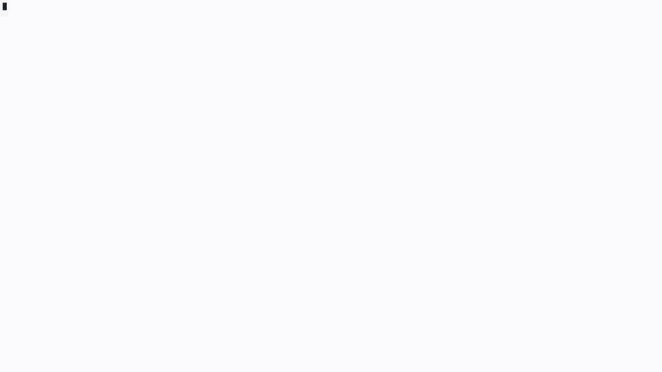

# cchat

[English](README.md) | **한국어**

Claude Code를 브라우저(PC·폰)에서 쓰는 웹 터미널. 맥 한 대에서 [ttyd](https://github.com/tsl0922/ttyd) + tmux로 claude 대화 여러 개를 띄워 두고, 아래 탭으로 오간다.

**누구를 위한 것:** Claude Code 작업 여러 개를 동시에 돌리면서 폰과 PC를 오가는 사람.

**장점**
- **폰과 PC가 같은 화면.** 둘 다 같은 tmux 대화를 연다. PC에서 하던 걸 폰에서 그대로 이어서 한다.
- **작업 이동이 탭 한 번.** 대화가 탭이라 폰은 한 번 누르면, PC는 Alt+숫자로 넘어간다.
- **진행 상황이 한눈에.** 깜빡임 = 작업 중, 주황 = 내 차례, 녹색 = 끝남. 하나씩 열어 볼 필요가 없다.
- **내 맥의 진짜 Claude Code.** 내 파일·도구·설정 그대로. 폰엔 설치할 것 없이 브라우저만.

**한계**
- 푸시 알림이 없다. 색은 페이지를 열어 둘 때만 보인다.
- macOS 전용이고, 맥이 켜져 있어야 한다.
- 밖에서 접속하려면 통로와 인증을 직접 갖춰야 한다.



*1분 사용 시연 ([mp4](docs/demo.mp4)). 화면 안내 문구는 영어입니다.*

## 설치

맥에서 Claude Code(또는 다른 코딩 에이전트)에 이 문장을 붙여 넣으면 됩니다:

```
https://github.com/efww/cchat 을 ~/cchat 에 clone하고, ~/cchat/INSTALL.md 를 읽고 그대로 따라서 이 맥에 cchat을 설치해줘.
```

필요한 것(macOS, Homebrew, Claude Code)을 확인하고 `ttyd`·`tmux`를 깐 뒤, 세 가지(작업 폴더, 권한 모드, 포트)를 물어보고 설치해서 페이지까지 열어 줍니다.

<details><summary>직접 설치</summary>

```sh
brew install ttyd tmux
git clone https://github.com/efww/cchat.git ~/cchat && cd ~/cchat
cp cchat.conf.example my.conf     # WORKDIR, PERMISSION_MODE, PORT 고치기
./install.sh -c my.conf
open "http://127.0.0.1:7681/cchat/?arg=1"
```

업데이트: `git pull && ./install.sh -c my.conf`. 지우는 법과 자세한 내용: [INSTALL.md](INSTALL.md)(영어).
</details>

## 무엇이 되나

- **대화 탭**: 맨 아래 두 줄이 대화 탭. 위 줄은 번호, 아래 줄은 대화 이름표(길면 `…`로 줄임).
  - 검정 = 지금 보는 대화
  - 녹색 = 답이 끝났는데 아직 안 본 대화
  - 주황 = 허락·질문을 기다리는 대화
  - 회색 깜빡임(1.5초) = 작업 중(여러 탭이 같은 박자로)
- **PC 단축키**: Alt(Option)+숫자 = 그 번호 대화, Alt+←/→ = 이전/다음. Ctrl+V는 PC 클립보드를 붙인다.
- **폰**: 손가락 드래그 스크롤, 키 바(Esc·Tab·화살표 등), 다크 테마.
- 대화는 tmux 안에 있어 브라우저를 닫아도 계속 돈다. URL `?arg=이름`으로 그 이름의 대화에 붙는다(없으면 만든다).

## 사용법

1. **대화 열기**: `http://127.0.0.1:7681/cchat/?arg=1`로 접속한다. `?arg=이름`마다 따로인 claude 대화이고, 새 이름이면 탭이 새로 생긴다.
2. **일 시키고 다른 탭으로**: 할 일을 입력하고 Enter, 그다음 **Alt+숫자**(또는 클릭)로 다른 탭으로 간다. 떠난 탭은 claude가 일하는 동안 회색으로 깜빡인다.
3. **색 보기**: 그 탭이 **녹색**이 되면 답이 나온 것, **주황**이면 허락이나 대답을 기다리는 것.
4. **돌아가기**: 탭을 클릭하거나 **Alt+←/→**. 탭을 열면 색이 지워진다. 주황 탭에서 허락하면 claude가 이어서 한다.
5. **브라우저는 아무 때나 닫아도 된다**: 대화는 tmux에서 계속 돈다. 다시 열면 그대로 있다. 대화에서 `/exit`를 치면 그 탭이 닫힌다.

폰에서는 탭을 눌러 옮기고, 손가락으로 끌어 스크롤하고, 키 바로 Esc·Tab·화살표를 쓴다.

## 밖에서 접속할 때 (주의)

ttyd는 127.0.0.1에만 열리고 **자체 인증이 없다**. 밖에서 쓰려면 `TUNNEL_HOST`(SSH 역방향 통로)로 서버에 열고, 그 앞에 반드시 인증(Cloudflare Access, OAuth 프록시 등)을 둔다.
`PERMISSION_MODE=bypassPermissions`는 claude가 확인 없이 명령을 실행하므로, 접속 인증이 확실할 때만 쓴다.

## 구성

| 파일 | 역할 |
|---|---|
| `bin/cchat-session` | ttyd가 접속마다 실행. tmux 대화에 붙고, 안에서 claude를 반복 실행 |
| `bin/cchat-tabs` | 상태줄 대화 탭 그리기, 클릭·단축키 전환 |
| `bin/cchat-unread` | claude 훅(완료·허락·작업 시작)에서 탭 색 표시 |
| `bin/cchat-build-index` | ttyd 기본 화면에 cchat 부분(테마, 폰 키 바·스크롤, 단축키, 깜빡임)을 넣어 `index.html` 생성 |
| `bin/cchat-label` | 대화 이름표 직접 달기 |
| `bin/cchat-tunnel` | (선택) SSH 역방향 통로 |
| `bin/cchat-update` | (선택) 매일 claude CLI 업데이트 |
| `config/` | tmux 설정, claude 설정(테마·훅) |
| `launchd/` | 서비스 정의 |

탭 이름표는 `~/.cache/cchat-tablabel/<대화>` 파일이 있으면 그것(상태줄 스크립트 등에서 써 넣을 수 있음), 없으면 claude가 붙인 대화 제목을 쓴다.

## License

MIT
