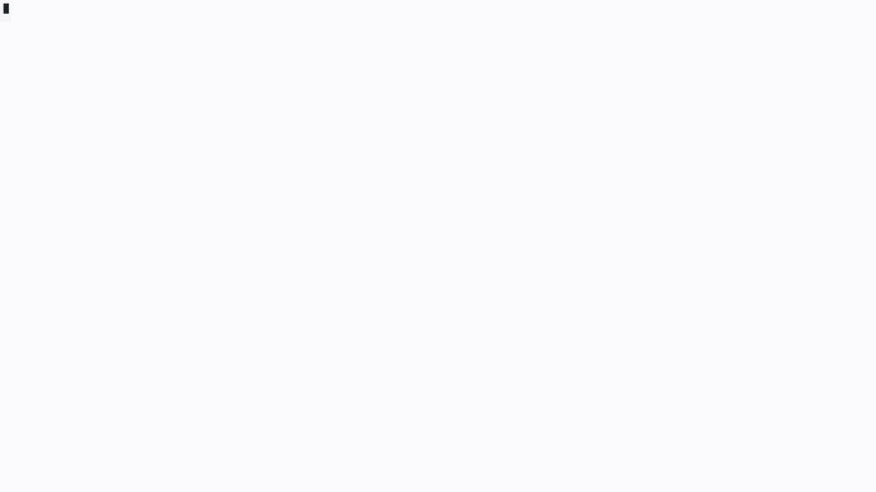
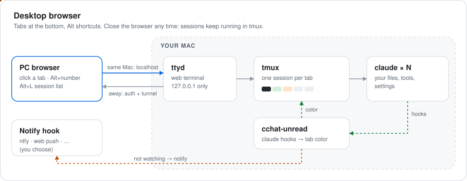
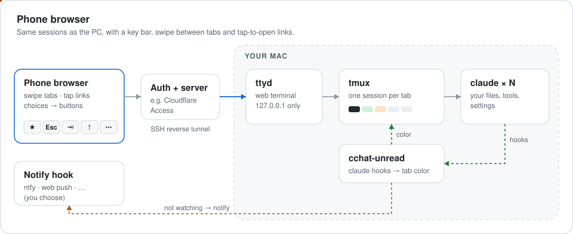
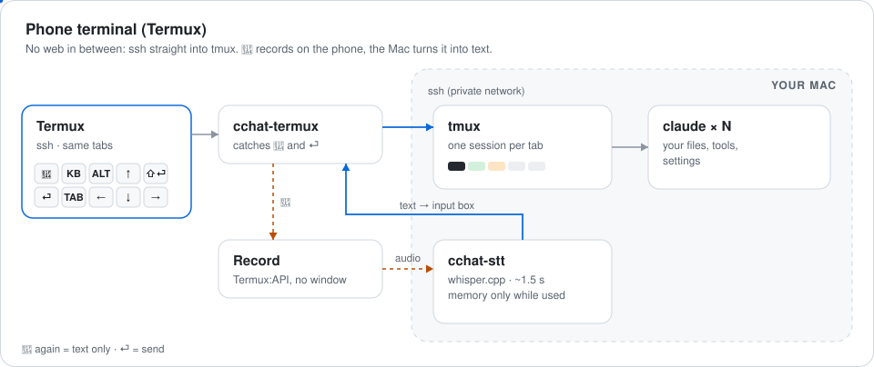

# cchat

**English** | [한국어](README.ko.md)

A browser front-end (desktop and phone) for [Claude Code](https://docs.anthropic.com/claude-code) running on a Mac. It uses [ttyd](https://github.com/tsl0922/ttyd) + tmux to keep several claude sessions alive and lets you switch between them with tabs at the bottom of the screen.

**For** people who run several Claude Code jobs at once and switch between phone and PC.

**Why**
- **Same screen on phone and PC.** Both open the very same tmux sessions — start on the PC, continue on the phone mid-task.
- **One tap between jobs.** Sessions are tabs; switching is a single tap or Alt+number.
- **Status at a glance.** Spinner next to the tab number = working, orange = needs you, green = done. No need to open each session.
- **Your real Claude Code.** Runs on your own Mac with your files, tools and settings. Nothing to install on the phone — just a browser.

**Limits**
- Notifications need a small hook you choose (examples for [ntfy](examples/notify-ntfy) and [macOS](examples/notify-macos) included); no push server is bundled.
- macOS only, and the Mac must stay on.
- Remote access needs your own tunnel + authentication.



*One-minute walkthrough ([mp4](docs/demo.mp4)).*

## Install

Paste this into Claude Code (or any coding agent) on your Mac:

```
Clone https://github.com/efww/cchat to ~/cchat, then read ~/cchat/INSTALL.md and follow it to install cchat on this Mac.
```

It checks the requirements (macOS, Homebrew, Claude Code), installs `ttyd` and `tmux`, asks you three things (work folder, permission mode, port), installs, and opens the page.

<details><summary>Manual install</summary>

```sh
brew install ttyd tmux
git clone https://github.com/efww/cchat.git ~/cchat && cd ~/cchat
cp cchat.conf.example my.conf     # edit: WORKDIR, PERMISSION_MODE, PORT
./install.sh -c my.conf
open "http://127.0.0.1:7681/cchat/?arg=1"
```

Update: `git pull && ./install.sh -c my.conf`. Uninstall and details: [INSTALL.md](INSTALL.md).
</details>

## Features

- **Session tabs**: the bottom two rows are session tabs. The top row shows the number; the bottom row shows the session label (cut off with `…` when too long).
  - Black = the session you are viewing
  - Green = finished replying, not seen yet
  - Orange = waiting for your permission or answer
  - Faded tab = idle for over 1 hour (background blends into the bar, text dimmed)
  - Spinner (⠋⠙⠹…) next to the number = working (all tabs spin in sync). Keeps spinning while background shells or agents run after the reply, then turns green
  - The label row ends with the time a working tab has been busy (`3m`) or the conversation size (`42k` tokens)
  - **+** at the end opens a new session; when tabs overflow, ◀ ▶ show how many hidden tabs need you (`▶2`)
- **Desktop shortcuts**: Alt(Option)+number = go to that session, Alt+←/→ = previous/next, Alt+↑/↓ = tab above/below (multi-row tabs), Alt+A = next tab that needs you, Alt+L = Claude session list (time since each tab last worked, overall goal and current step, close; also claude running outside cchat; summaries are prepared in the background with claude haiku when a turn starts or ends), Alt+O = overview of all sessions (screen previews). Shift+Enter = new line (does not send). Ctrl+V pastes your local (browser) clipboard.
- **Terminal app instead of the browser**: see [Phone terminal (Termux)](#phone-terminal-termux) below.
- **Phone**: finger-drag scrolling, swipe left/right to change tabs, tap a URL to open it (wrapped URLs too), dark theme. Key bar: ★ = next tab that needs you, Esc, Tab, arrows, ⋯ = session list (☰), voice input, saved prompts (✎), photo/file upload (📎, remote relay only).
- **Approve with one tap**: when claude shows a numbered choice (permission, question), the numbers appear as buttons.
- **Helpers you can ask claude to use**: `cchat-send 1 2` (pass tab 1's last answer to tab 2's input), `cchat-history` (find and reopen closed conversations), `cchat-snip` (saved prompts), `cchat-label` (tab names), `cchat-set` (settings).
- Sessions live inside tmux, so they keep running after you close the browser. Open the URL with `?arg=name` to attach to that session (created if missing).

## How it fits together

The sessions live in tmux on your Mac; every device is just a window onto them, so each one shows the same tabs and the same conversations.







### Phone terminal (Termux)

Instead of the browser, ssh in from a terminal app and attach to tmux directly (`tmux -u -L cchat attach`, no web in between).

- **Connect script**: copy `bin/cchat-termux` into Termux and run `cchat-termux user@mac` (`--mosh` uses mosh and fixes touch and scrolling, which plain mosh breaks for Termux).
- **🎤 voice input** (F12 in the key row): press to record on the phone with no window or keyboard (Termux:API), press 🎤 again to send it to the Mac, where `cchat-stt` (whisper.cpp, Korean by default) turns it into text in the input box. Press ⏎ instead of 🎤 to stop and send right away. Needs `brew install whisper-cpp` and a model in `~/.cache/cchat-whisper/` on the Mac; memory is used only while transcribing.
- **🎤 in any program**: put `[ -z "$CCHAT_VOICE" ] && [ -t 0 ] && cchat-termux --shell && exit` at the top of `~/.bashrc` (Mac address in `~/.config/cchat-termux/host`, ssh key login to the Mac) and it works in Codex, Gemini or any other ssh too.
- **Key row example** (`~/.termux/termux.properties`): `extra-keys = [[{key: 'F12', display: '🎤'},'KEYBOARD','ALT','UP',{macro: 'ALT ENTER', display: '⇧⏎'},'BKSP'],[{key: 'ENTER', display: '⏎'},'TAB','LEFT','DOWN','RIGHT','ESC']]`. `KEYBOARD` is needed because with tmux mouse mode on, Termux passes screen taps to the program and does not bring the keyboard back.
- **Colors**: save `cchat-build-index --termux dark` (or `light`) as `~/.termux/colors.properties`. In terminals whose color schemes stop at 16 colors (e.g. Windows Terminal), run `cchat-build-index --osc dark` right before attaching (`--osc reset` restores).
- **Working mark**: terminals have no page spinner, so it is drawn as a character next to the tab number (one step per 5 s). `cchat-set tab busy play` shows a still green ▶ instead.

## How to use

1. **Open a session**: go to `http://127.0.0.1:7681/cchat/?arg=1`. Each `?arg=name` is its own claude session; a new name creates a new tab.
2. **Start a task and move on**: type your prompt, press Enter, then switch to another tab with **Alt+number** (or click it). The tab you left shows a spinner next to its number while claude works.
3. **Watch the colors**: when that tab turns **green**, the answer is ready; **orange** means claude is waiting for your approval or an answer.
4. **Go back**: click the tab, or use **Alt+←/→**. Opening a tab clears its color. Approve in the orange tab and claude continues.
5. **Close the browser any time**: sessions keep running in tmux. Open the page again and everything is where you left it. Type `/exit` in a session to close its tab.

On a phone, tap a tab to switch; drag with your finger to scroll, and use the key bar for Esc, Tab and arrows.

## Settings: just ask

Tell claude in any cchat tab, e.g. "dark theme on my PC" or "bigger font on my phone". It uses `cchat-set` (run it yourself if you prefer):

| Command | Effect |
|---|---|
| `cchat-set` | Show current settings |
| `cchat-set tab ctx off` | Hide the conversation size (42k) on tabs |
| `cchat-set tab rows 2` | Tab rows, 1–5. 1 (default) = each tab is two lines tall (number/name); 2 = two-line tabs (number/name) in 2 rows, 3–5 = one-line tabs spread over that many rows (for many tabs); changing rows resets the height to that default |
| `cchat-set tab height 1.5` | Tab height in multi-row mode (tab rows 2–5). 1 (default) = one text line, 1.5 = one and a half (padding drawn with block characters), 2 = number on top and name below like the default mode. The status bar holds at most 5 lines, so rows × height is capped |
| `cchat-set tab busy play` | Working mark in terminal clients (Termux etc.): `spinner` (default, one step per 5 s) or a still green ▶. The browser always spins |
| `cchat-set font phone 16` / `font pc off` | Font size per device (`off` = `FONT_SIZE`) |
| `cchat-set theme pc dark` | Light/dark per device (default: PC light, phone dark) |
| `cchat-set notify on\|off`, `notify pc\|phone\|telegram\|done\|ask on\|off`, `quiet 01-08` | Notifications (needs a notify hook, see below) |

Font and theme apply after a browser reload. Notifications: if `~/.config/cchat/notify` exists and is executable, cchat runs it as `notify <session> <done|ask|test>` (with `CCHAT_NOTIFY_DEVICES`) whenever a tab you are not looking at turns green or orange. cchat does not ship a push server; the hook can send to anything (web push, ntfy, Telegram…). Ready-made: `cp examples/notify-ntfy ~/.config/cchat/notify` (edit `TOPIC` inside), then `cchat-set notify test`.

## Remote access (read this)

ttyd listens on 127.0.0.1 only and has **no authentication of its own**. To use it from outside, expose it through `TUNNEL_HOST` (a reverse SSH tunnel to your server) and always put authentication in front of it (Cloudflare Access, an OAuth proxy, etc.).
`PERMISSION_MODE=bypassPermissions` lets claude run commands without asking — use it only when access is properly authenticated.

## Layout

| File | Role |
|---|---|
| `bin/cchat-session` | Run by ttyd for each connection. Attaches to a tmux session and runs claude in a loop inside it |
| `bin/cchat-tabs` | Draws the session tabs in the status line; handles clicks and shortcuts |
| `bin/cchat-unread` | Called by claude hooks (done, permission, started work) to color the tabs |
| `bin/cchat-build-index` | Builds `index.html` from ttyd's default page plus the cchat parts (themes, phone key bar and scrolling, shortcuts, working spinner) |
| `bin/cchat-set` | View and change settings (`~/.config/cchat/settings`) |
| `bin/cchat-send` · `bin/cchat-history` · `bin/cchat-snip` | Pass an answer between tabs · reopen closed conversations · saved prompts |
| `bin/cchat-ttyd` | Starts ttyd (rebuilds the page after a ttyd upgrade; `KEEP_AWAKE=1` keeps the Mac awake) |
| `bin/cchat-inbox` | (optional, `INBOX_REMOTE`) pulls files uploaded from the phone |
| `examples/` | Notification hook examples (ntfy, macOS) |
| `bin/cchat-ls` | Claude session list (Alt+L, ☰): per tab time since last work, goal, current step, close; summaries prepared with claude haiku |
| `bin/cchat-termux` | (copy to Termux) ssh/mosh connect + 🎤 voice input, `--shell` wraps the whole shell |
| `bin/cchat-stt` | Speech to text (whisper.cpp), called over ssh by cchat-termux |
| `docs/diagrams.py` | Generates the architecture pictures in this README (`docs/arch-*.svg`) |
| `bin/cchat-label` | Set a session label by hand |
| `bin/cchat-restart` | Restart claude in every tab (e.g. after an update), resuming each conversation; busy tabs are skipped unless `--all` |
| `bin/cchat-tunnel` | (optional) reverse SSH tunnel |
| `bin/cchat-update` | (optional) daily claude CLI update |
| `config/` | tmux config, claude settings (theme, hooks) |
| `launchd/` | Service definitions |

Tab labels come from `~/.cache/cchat-tablabel/<session>` if that file exists (e.g. written by your status line script); otherwise the title claude gave the conversation is used.

Code comments are in Korean.

## License

MIT
